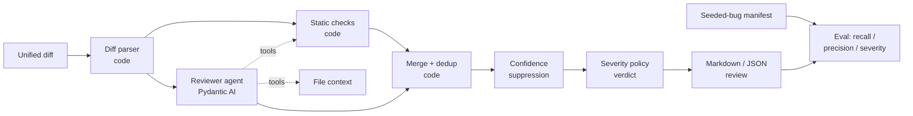

# agent-code-review

PRs wait days for review, and when the review comes it's a skim. The
obvious fix — point an LLM at the diff — fails a different way: it
dumps 40 nitpicks, half of them wrong, and the team mutes it within a
week. An AI reviewer only survives in production if it's built like a
production system: deterministic checks catch the mechanical stuff,
the model reviews for logic/security/design, every finding carries a
severity and a confidence, low-confidence noise is suppressed instead
of posted, and the whole thing is measured against seeded bugs so you
know its precision instead of hoping.

This repo is that reviewer, built on Pydantic AI. It takes a unified
diff (or a git repo ref range) and produces a structured review:
findings with file, line, severity (blocker/major/minor/nit), category
(bug/security/perf/style/design), confidence, message, and a concrete
suggestion — rendered as a markdown review with inline-comment format
(`file:line — [severity] message`) or as JSON. A seeded-bug benchmark
ships with it: three sample PRs (clean, buggy, security) with a
manifest of known defects, so recall and precision are numbers, not
vibes.

## How it works



1. **Parse** — a unified-diff parser turns the diff into per-file
   structures with exact new-file line numbers (multi-file, renames,
   binary files, new/deleted files).
2. **Static checks** — eight deterministic checks run on added lines
   only: bare `except:`, mutable default args, SQL built by string
   formatting, hardcoded secrets, HTTP calls without timeouts,
   `eval`/`exec`, TODOs without tickets, debug prints. Same input,
   same findings, no model involved.
3. **Agent review** — a Pydantic AI agent with a behavior-only system
   prompt and typed tools (`list_changed_files`, `run_static_checks`,
   `get_file_context`) reviews for what patterns can't see: logic
   bugs, security design, broken error handling. Its output is a
   validated `ReviewReport`, not prose to parse.
4. **Policy** — code, not the model, decides what gets posted:
   findings from both layers are deduplicated on (file, line,
   category), anything below the confidence threshold (default 0.7)
   is suppressed and counted, and the verdict is `block` iff a
   blocker or major survives.
5. **Evals** — the seeded-bug benchmark scores the reviewer: recall
   per sample, precision (findings matching no seeded defect are
   false positives), severity accuracy, and blockers on the clean PR.

## Quickstart

```bash
pip install -e ".[dev]"          # mock mode: no API key, no network
pytest -q                        # 64 tests, all offline
python -m agent_code_review.demo # review the 3 sample PRs + eval table
```

Review your own diff (exit code 1 when policy blocks — CI-friendly):

```bash
python -m agent_code_review path/to/change.diff
python -m agent_code_review --repo . --range HEAD~1..HEAD --json
```

Optional live mode (real Gemini model does the logic-level review;
static checks and policy are unchanged):

```bash
pip install -e ".[live]"
export GEMINI_API_KEY=...        # GEMINI_MODEL overrides the model
python -m agent_code_review.demo --live
```

Live mode defaults to `gemini-3.5-flash-lite` via Pydantic AI's
Google provider.

## Why Pydantic AI

Findings are structured data. A review pipeline needs to sort,
filter, deduplicate, threshold, and score them — none of which works
if the model returns paragraphs. Pydantic AI's core is exactly this:
typed output schemas with validation and retries, so the agent
returns a `ReviewReport` of typed `Finding` objects or it doesn't
return at all. The mock/live split is also clean: mock mode swaps in
a deterministic `FunctionModel` that calls the same tools and emits
the same schema, so the full loop is testable offline.

## Production patterns in this repo

- **Deterministic layer under the LLM.** Mechanical defects are
  caught by code with reproducible results; the model spends its
  attention on logic and design. Static findings are merged into the
  final report directly, so a live model that ignores its tools
  cannot lose them.
- **Severity policy in code.** The model proposes severities; the
  merge verdict is computed by policy (blocker + major block).
  Changing what blocks a merge is a code change with tests, not a
  prompt tweak.
- **Confidence thresholding / false-positive control.** Every finding
  carries a confidence. Below-threshold findings are suppressed and
  *counted in the report*, so suppression is auditable. The debug-
  print check ships at 0.55 confidence precisely so it demonstrates
  this: it fires, and policy keeps it out of the posted review.
- **Deduplication.** The static layer and the agent often flag the
  same line. Findings collapse on (file, line, category), keeping
  the higher-confidence version — one comment per issue.
- **Seeded-bug evals.** Three sample PRs with a manifest of 10 known
  defects. Mock-mode numbers: buggy PR recall 6/7 (the miss is a
  seeded off-by-one logic bug — pattern checks can't see it, and the
  eval says so), security PR recall 3/3, clean PR 0 blockers,
  precision 1.000 across the board, severity accuracy 1.000. The
  off-by-one is the honest argument for the LLM layer: live mode is
  expected to catch it, and the benchmark will tell you whether it
  did. **Live-verified (Gemini free tier, `gemini-3.5-flash-lite`):
  the live reviewer caught the off-by-one** — `items[len(items)]`
  flagged as an IndexError major with the `items[-1]` fix — taking
  buggy-PR recall to 7/7, with the static findings merged in and
  the debug print still suppressed by policy.
- **Inline-comment output.** Findings render as
  `file:line — [severity] message` with a suggestion, blocking
  findings first — the shape a forge's review API consumes.

## What's real vs mocked

| Piece | Mock mode (default) | Live mode |
|---|---|---|
| Diff parsing, static checks, policy, dedup, suppression | real, deterministic | identical |
| Agent loop (prompt, tools, structured output) | real Pydantic AI loop on a deterministic `FunctionModel` that calls the static-checks tool and reports its findings | real Gemini model via the Google provider |
| Logic/design findings | **none** — mock reports static findings only (seeded off-by-one is missed; eval shows recall 6/7) | model-generated, still policy-filtered |
| Severity/confidence on static findings | fixed per check, in code | identical |
| Eval matching | deterministic (±2 lines, same category) | identical |

## Layout

```
src/agent_code_review/
  models.py        Finding / ReviewReport schemas
  diff_parser.py   unified-diff parser (renames, binary, /dev/null)
  static_checks.py 8 deterministic checks over added lines
  policy.py        severity policy, suppression, dedup, verdict
  prompts.py       behavior-only system prompt
  tools.py         typed agent tools over the parsed diff
  mock_model.py    deterministic FunctionModel for offline runs
  agent.py         Pydantic AI agent + review pipeline + git input
  report.py        markdown (inline comments) + JSON rendering
  evals.py         seeded-bug benchmark (recall/precision/severity)
  demo.py          one-command demo over the sample PRs
samples/           clean_pr.diff, buggy_pr.diff, security_pr.diff,
                   manifest.json (10 seeded defects)
tests/             64 offline tests
```

## Limitations

- Static checks are line-pattern based (the timeout check follows
  multi-line calls up to 8 lines; most others are single-line).
  AST-level analysis would catch more; patterns keep the layer
  dependency-free and auditable.
- The secret check is heuristic: it knows common assignment names
  and key formats, and skips obvious placeholders. It is a safety
  net, not a substitute for a real secret scanner.
- Eval matching allows ±2 lines and requires the same category —
  a finding with the right line but wrong category counts as a miss
  plus a false positive. Deliberately strict.
- The sample PRs are small and Python-only. The parser is
  language-agnostic; most static checks are Python-specific.
- Live mode is implemented and construction-verified; treat its
  eval numbers as the thing to check on first real run — that's
  what the benchmark is for.
